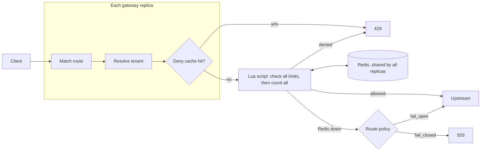

# Headgate

An API gateway in Go that enforces rate limits correctly across many replicas.

Rate limiting with a counter in each gateway instance lets through N times the intended traffic when there are N instances. Headgate keeps the counters in Redis and makes every check-and-update a single atomic Lua script, so limits hold however many replicas serve the traffic. On top of that it adds a local cache that absorbs abusive traffic, a per-route policy for when Redis is down, and limits per API key, per tenant and per route on the same request.

## Measured results

| | |
|---|---|
| **Accuracy across 8 replicas** | Sliding-log limits: **zero overshoot**. The worst count in any 1-second span equalled the limit exactly, for every key and tenant |
| **Why shared state matters** | Per-instance counters on 3 replicas let through exactly **3.000×** the limit; Redis + Lua brought it to **1.000×** |
| **Why atomicity matters** | A read-then-increment version let **10 to 35%** extra through under concurrency; the Lua script allowed exactly the limit |
| **Local deny cache** | **80 to 82% fewer Redis calls** under 6× abusive overload (fixed window, sliding log), with no change in what's allowed |
| **Added latency** | **0.8 ms** median as seen by the client, of which 0.4 ms is inside the gateway (about 0.3 ms of that is the Redis call) |
| **Redis outage** | Fail-closed routes return 503 and fail-open routes keep serving, each within the 50 ms decision budget; limiting resumes **1 to 2 s** after Redis returns |

Every number comes from an experiment in this repository. The method and caveats are in [docs/](docs/). Throughput and tail latency were measured on a single laptop, where the host is the bottleneck (about 5k req/s). See [docs/scale.md](docs/scale.md).

## How a request flows



## Features

- **Three algorithms behind one interface**: fixed window, sliding window log, sliding window counter. Each is one Redis Lua script that reads Redis's own clock, so replicas agree on window boundaries. Measured comparison: [docs/algorithms.md](docs/algorithms.md).
- **Several limits on one request**: per API key, per tenant and per route, checked all-or-nothing in one round trip. A request that one limit rejects uses up nothing on the others. [docs/multi-limits.md](docs/multi-limits.md).
- **Local deny cache**: when Redis says "denied, retry in X", the replica denies locally until X. It can never let extra requests through. [docs/local-cache.md](docs/local-cache.md).
- **Fail-open or fail-closed per route**, with a hard per-decision time budget, a warm connection pool and no retries. [docs/failure-modes.md](docs/failure-modes.md).
- **Prometheus metrics** on a separate port: outcomes, denials by scope, decision, upstream and overhead histograms, cache and pool stats. [docs/metrics.md](docs/metrics.md).

## Quick start

Needs Docker. Starts Redis, a test backend and 3 gateway replicas (8 with `--profile scale`):

```sh
docker compose -f deploy/docker-compose.yml up --build -d
```

```sh
$ curl -i -H "X-API-Key: key-0" localhost:8081/hello
HTTP/1.1 200 OK
X-Ratelimit-Limit: 100
X-Ratelimit-Remaining: 99
X-Ratelimit-Scope: key

$ curl -i localhost:8081/hello
HTTP/1.1 401 Unauthorized

$ curl -s localhost:9101/metrics | grep headgate_requests_total
headgate_requests_total{outcome="allowed",route="default"} 1
headgate_requests_total{outcome="no_key",route="default"} 1
```

Gateways listen on `localhost:8081` to `8083` (to `8088` with `--profile scale`), and their metrics on `9101` to `9103`.

## Configuration

```yaml
listen: ":8080"
metrics_listen: ":9100"
upstream: "http://upstream:9000"
backend: redis

redis:
  addr: "redis:6379"
  timeout: 50ms            # budget for one rate-limit decision
  min_idle_conns: 16

deny_cache:
  enabled: true
  max_keys: 100000

tenants:
  acme: [key-0, key-1]     # unknown keys share the tenant "_unassigned"

routes:
  - name: payments
    path_prefix: /payments
    algorithm: sliding_log           # fixed_window | sliding_log | sliding_counter
    on_redis_error: fail_closed      # fail_open | fail_closed
    limits:
      - per: key                     # key | tenant | route
        limit: 100
        window: 1s
      - per: tenant
        limit: 150
        window: 1s
```

The full deployed example is [deploy/headgate.yaml](deploy/headgate.yaml). `${VAR}` references are filled in from the environment.

## Tests and experiments

```sh
go test ./...                                         # unit tests (Redis tests skip)

docker compose -f deploy/docker-compose.yml up -d redis
HEADGATE_REDIS_ADDR=localhost:6379 go test ./... -count=1             # against real Redis
HEADGATE_REDIS_ADDR=localhost:6379 HEADGATE_EXPERIMENTS=1 \
  go test ./internal/limiter/ -run Experiment -v -count=1             # measurements behind the docs
```

Load tests use k6 through compose (`bench/k6/`): `overshoot.js` for accuracy, `failover.js` for Redis outages, `overhead.js` for latency (through the gateway vs direct, same run), `ramp.js` for throughput. For example:

```sh
docker compose -f deploy/docker-compose.yml run --rm k6 run /scripts/overshoot.js
```

From Git Bash on Windows, prefix with `MSYS_NO_PATHCONV=1`.

## Layout

```
cmd/gateway         load config, build routes, serve traffic and metrics
cmd/upstream        test backend that records what was allowed (the accuracy oracle)
internal/limiter    Limiter interface, Redis Lua scripts, deny cache, memory baseline
internal/gateway    routing, tenant resolution, failure policy, overhead timing
internal/config     YAML config and validation
internal/metrics    Prometheus metrics
internal/rolling    worst rolling-window count from timestamps
deploy/             docker compose and gateway config
bench/k6/           load test scripts
docs/               measured write-ups
```

## Known limitations

- **Single Redis node.** The multi-limit script touches keys in different Redis Cluster slots.
- **Static tenant map in config.** There's no authentication; a real deployment would resolve tenants through its auth service.
- **Sharing inside a tenant is first-come**, not fair: an abusive key can take most of a tight tenant limit.
- **Fail-open means no limiting during an outage.**
- **The sliding counter can reach about 2× its limit** at window edges or when a client starts sending mid-window (measured in [docs/algorithms.md](docs/algorithms.md)). Use the sliding log when the limit must hold for every 1-second span.
